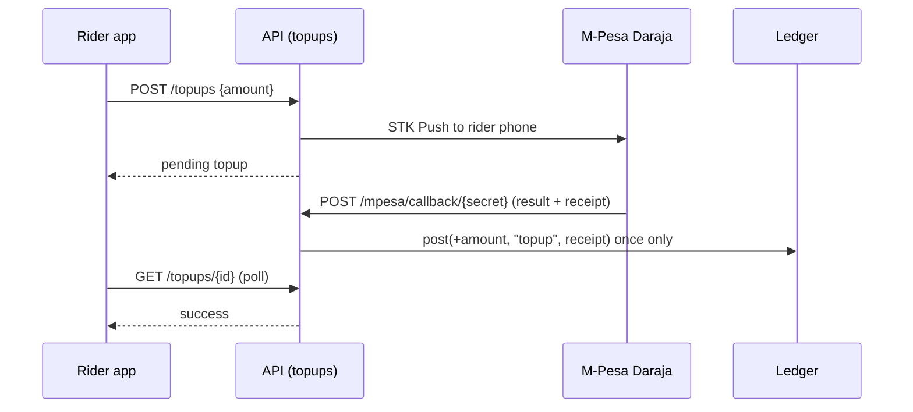
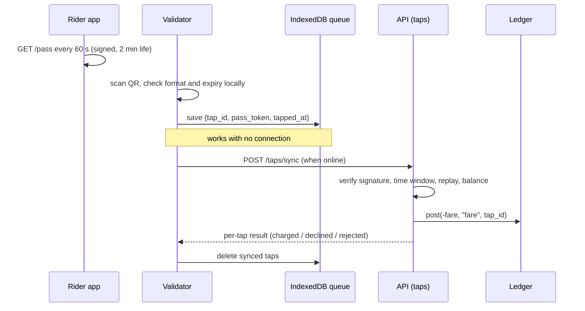

# Architecture

## Big picture

```
 Rider phone            Validator (phone/laptop)         Operator browser
 web/rider              web/validator                    web/operator
 - QR pass              - camera scan                    - revenue, demand
 - top-up               - IndexedDB queue (offline)      - flags, payouts
        \                    |  (syncs when online)        /
         \                   |                            /
          v                  v                           v
        +-------------------------------------------------+
        |  FastAPI service  (app/main.py, /api/*)         |
        |  routers -> domain modules -> models            |
        |                                                 |
        |  ledger  trips  payouts  fraud  analytics       |
        +-----------+---------------------+---------------+
                    |                     |
                    v                     v
          SQL database               M-Pesa Daraja
          (SQLite or Postgres)       (mock or live STK Push)
```

The same FastAPI process also serves the three web apps as static files, so there is no separate
front-end server.

## Design rules

1. **The ledger is the truth.** A rider's balance is the sum of their `wallet_ledger` rows. Rows are only added, never edited.
2. **Everything that can repeat is idempotent.** A top-up is keyed by its M-Pesa receipt, a fare by its tap id. Re-sending either changes nothing.
3. **The gate never waits for the network.** The validator accepts a readable, unexpired pass and queues it. The server decides charge, decline or reject on sync.
4. **The card is only a key.** The QR pass identifies an account; fares, balances and rules live on the server (account-based ticketing).
5. **Keep logic in domain modules, not routers.** Routers parse requests and call modules.

## Module map

Dependencies point downward: a module only imports from modules listed above it.

| Layer | Module | Responsibility | Uses | Used by |
| --- | --- | --- | --- | --- |
| Foundation | `config.py` | Settings from environment | - | everything |
| | `timeutil.py` | Naive-UTC helpers | - | models, trips, analytics, fraud |
| | `db.py` | Engine, session, `init_db` | config | models, routers, seed |
| | `models.py` | All tables | db, timeutil | every domain module |
| Domain | `security.py` | PIN hashing, JWTs, auth dependencies | config, db, models | routers, trips, seed |
| | `mpesa.py` | STK Push, callback parsing, mock mode | config | routers/topups, schemas |
| | `ledger.py` | Balance, idempotent posting, history | models | trips, topups, wallet, seed |
| | `trips.py` | Turn a scan into a charged/declined/rejected trip | ledger, security, models | routers/taps |
| | `payouts.py` | Simulated operator settlement | models, config | routers/operator |
| | `fraud.py` | Rules and anomaly model | models, config | routers/operator |
| | `analytics.py` | Dashboard numbers | models, config | routers/operator |
| Interface | `schemas.py` | Request bodies | mpesa | routers |
| | `routers/auth.py` | Register, login | security, models | main |
| | `routers/wallet.py` | Balance, history, QR pass | ledger, security | main |
| | `routers/topups.py` | Top-up, M-Pesa callback, mock confirm | mpesa, ledger | main |
| | `routers/taps.py` | Validator config and tap sync | trips | main |
| | `routers/operator.py` | Summary, flags, payouts | analytics, fraud, payouts | main |
| Entry | `main.py` | Wires routers, start-up, static files | all routers, seed | uvicorn |
| Tooling | `seed.py` | Demo data and simulated history | models, ledger, security | main (core), CLI |

## Front-end map

| App | Files | Calls |
| --- | --- | --- |
| Rider | `web/rider/index.html`, `app.js` | `/auth/*`, `/wallet`, `/pass`, `/topups`, `/dev/mpesa/confirm/*` |
| Validator | `web/validator/index.html`, `app.js`, `sw.js` | `/validator/config`, `/taps/sync` |
| Operator | `web/operator/index.html`, `app.js` | `/auth/operator/login`, `/operator/*` |
| Shared | `web/shared/api.js`, `style.css` | fetch wrapper, formatting helpers, theme |

## Request flows

### Top-up



### Tap and sync



### Payout

Operator clicks Run payout -> `payouts.run_payout` gathers charged trips with no payout id,
deducts the platform fee, stores a `payouts` row, stamps the trips -> trips can never be paid twice.

## Decisions and trade-offs

| Decision | Why | What changes at scale |
| --- | --- | --- |
| Plain HTML/JS front-ends served by FastAPI | One service, no build step, works offline easily | Port screens to React or Next.js; the API does not change |
| SQLite by default, Postgres by setting `DATABASE_URL` | Zero setup locally, same code on Supabase | Add migrations (Alembic) before real data |
| Fare charged at tap-in, flat per boarding point | Simplest correct model for a demo | Add tap-out and distance fares in `trips.py` and a fares table |
| Whole-shilling integers for money | Matches M-Pesa amounts, avoids float errors | Keep integers or move to minor units |
| Shared-secret signed QR (HS256) | Simple, forgery-proof for the server | Move to public-key signing so validators can verify offline |
| Simulated payouts | No licence is needed to demo | Real settlement needs a licensed partner (see ROADMAP) |
| Demo seed data on start-up (`AUTO_SEED=1`) | Instant showcase | Set `AUTO_SEED=0` and remove demo keys and passwords |

## Where to start reading the code

`app/main.py` -> `app/routers/taps.py` -> `app/trips.py` -> `app/ledger.py`. That path is the whole
tap-to-charge story in about 150 lines.
