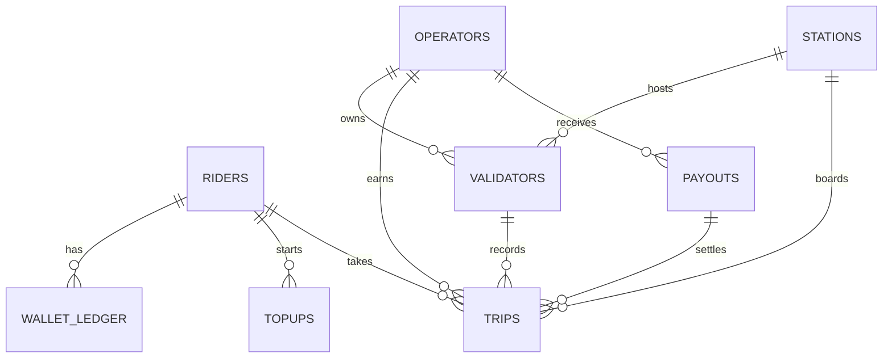

# Data model

## The ledger rule

`wallet_ledger` never has rows edited or deleted. Balance = `SUM(amount)` for the rider.
`UNIQUE (kind, ref)` means the same M-Pesa receipt (kind `topup`) or the same tap id (kind `fare`)
can post only once, even if a callback or sync is repeated.

## Tables

| Table | Key columns | Notes |
| --- | --- | --- |
| `riders` | id, phone (unique, `2547XXXXXXXX`), name, pin_hash | PIN stored as salted PBKDF2 |
| `operators` | id, name, username (unique), password_hash | Dashboard login |
| `stations` | id, name, order_index, fare | Boarding points; flat fare per point (KES) |
| `validators` | id, name, api_key (unique), operator_id, station_id | A device fixed to one operator and one point |
| `topups` | id, rider_id, amount, phone, checkout_request_id (unique), status, mpesa_receipt | `pending`, `success` or `failed` |
| `wallet_ledger` | id, rider_id, amount (+/-), kind, ref, created_at | `topup`, `fare` or `adjustment` |
| `trips` | id (tap id from the device), rider_id, validator_id, station_id, operator_id, pass_jti, tapped_at, fare, status, reason, payout_id | `charged`, `declined`, `rejected` |
| `payouts` | id, operator_id, period_start, period_end, trips_count, gross, fee, net, status | Simulated settlement |

## Trip status and reason

| Status | Reason | Meaning | Money moves? |
| --- | --- | --- | --- |
| charged | - | Fare debited once | Yes |
| declined | insufficient_funds | Balance minus fare would pass the overdraft limit | No |
| rejected | invalid_pass | Signature failed or not a pass | No |
| rejected | stale_pass | Tap time outside the pass's validity window | No |
| rejected | replayed_pass | Same pass already used on another tap | No |
| rejected | unknown_rider | Valid signature, rider no longer exists | No |

## Time and money

- All datetimes are stored as naive UTC. Reports convert to Nairobi time (UTC+3, `LOCAL_UTC_OFFSET_HOURS`).
- All money is whole Kenya shillings (integers).

## Distance fare additions

| Table or column | Notes |
| --- | --- |
| `fares` | `from_station_id`, `to_station_id`, `price`. Unique per pair, one row per direction. A station with outgoing rows is a distance station. |
| `tap_outs` | One row per exit scan: id (tap id from the device), rider, station, operator, pass id, tap time, `status` (`settled`, `cancelled`, `orphan`, `ignored`, `rejected`), `reason`, `trip_id`, `final_fare`, `refund` |
| `trips.hold` | Amount debited at boarding (the maximum). `trips.fare` is the amount finally kept. |
| `trips.exit_station_id`, `exit_at`, `exit_tap_id` | Filled in when the journey settles |
| `wallet_ledger.kind = 'refund'` | Credit for the difference at exit, referenced by trip id (unique, so refunded once) |

`trips.status` values are now `open`, `charged`, `declined`, `rejected` and `cancelled`.
Only `charged` trips count as revenue and are paid out. Older databases are upgraded automatically on start-up.
