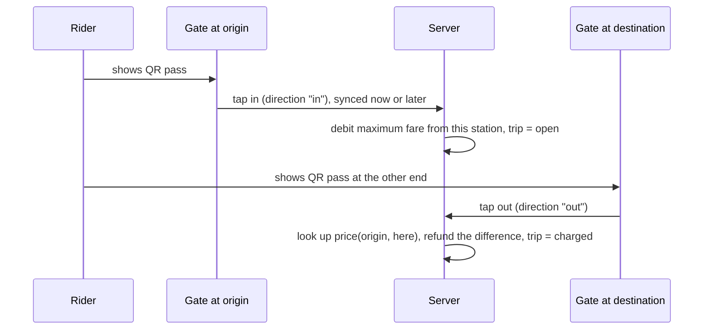

# Distance fares: boarding, alighting and settlement

The first version charged one flat fare for the station where a rider boarded. This version prices a
journey by where it starts and where it ends, and still works when gates are offline.

## How a fare is worked out

| Station type | Boarding scan | Alighting scan |
| --- | --- | --- |
| **Distance** (has rows in the fare table) | The **maximum** fare from that station is held (debited) and the trip is `open` | The exact fare for origin to here is found, the difference is **refunded**, the trip becomes `charged` |
| **Flat** (no rows, for example the feeder stop) | The flat fare is charged at once, trip is `charged` | Ignored (`flat_fare`): nothing to settle |

Why hold the maximum? The gate cannot know where the rider is going, and the rider may never tap out.
Holding the most they could owe means the operator is never short, and the exit scan returns the
difference. This is the same idea used by systems that charge a maximum fare when a rider skips a tap-out.



## Demo fare table (KES)

Priced by number of stops between stations. These are demo values, not official fares.

| Stops apart | 1 | 2 | 3 | 4 |
| --- | --- | --- | --- | --- |
| Fare | 30 | 45 | 60 | 80 |

Stations in order: Nairobi Central, Makadara, Githurai, Ruiru, Thika. Fares are the same in both
directions. The maximum from each station (what is held at boarding): Central 80, Makadara 60,
Githurai 45, Ruiru 60, Thika 80.

Worked example. A rider with KES 500 boards at Nairobi Central (KES 80 held, balance 420) and leaves at
Githurai (fare 45, KES 35 refunded, balance 455). The operator's revenue for the journey is KES 45.

## Rules and edge cases

| Situation | What happens |
| --- | --- |
| Rider never taps out | The held maximum is kept. The trip closes as `charged` with reason `no_tap_out` when the rider next boards, or after `OPEN_TRIP_HOURS` (default 6). The operator sees a `missed_tap_out` flag. |
| Tap out at the station where they boarded | Journey `cancelled`, fully refunded. |
| Exit scan syncs before the boarding scan (two devices, different sync order) | Stored as `orphan`. It is matched automatically when the boarding scan arrives. |
| Exit scan with no boarding scan at all | Stays `orphan`. After an hour it is flagged `exit_without_entry` (the rider may have boarded without tapping). Nothing is charged. |
| Same pass used twice in the same direction | The second scan is rejected as `replayed_pass`. One pass may be used once to board **and** once to exit. |
| Balance too low | The held maximum must fit inside the overdraft (KES 50). Otherwise the boarding scan is `declined`. |
| Station pair missing from the fare table | The held maximum is kept (`no_fare_for_pair`). |
| Open journeys and revenue | An open journey is a hold, not revenue. It counts toward revenue and payouts only after it settles or closes. |

## What the person at the gate does

Distance gates show a **Boarding / Alighting** switch. A gate at a station entrance stays on Boarding,
a gate at an exit stays on Alighting, and a single handheld device can be switched as needed. The choice
is saved on the device, stored with every tap, and survives reloads and offline use. Flat-fare gates show no switch.

## Changing the fares

Fares live in the `fares` table (one row per direction). For the MVP, edit them with a database tool or a
small script. An admin screen is on the roadmap.

```sql
UPDATE fares SET price = 50 WHERE from_station_id = 1 AND to_station_id = 3;
```

## Upgrading an existing database

Start the app as usual. On start-up it adds the new columns to `trips`, creates the `tap_outs` and `fares`
tables, builds the demo fare table if it is empty, and adds the extra demo gate devices. Older trips keep
working. For a clean demo run `python -m app.seed --reset --history`.

## Not included yet

Daily fare capping, peak and off-peak prices, zones, concessions, transfers between operators, and an
inspector mode for on-board checks.

## Tests

`tests/test_flow.py` covers boarding and alighting at different stations, both directions, the maximum
hold and refund, cancel, missed tap-out, late-arriving entry scans, replay protection for entry and exit,
the overdraft rule, flat-fare stops, operator revenue and payouts, the new fraud flags and the database upgrade.
